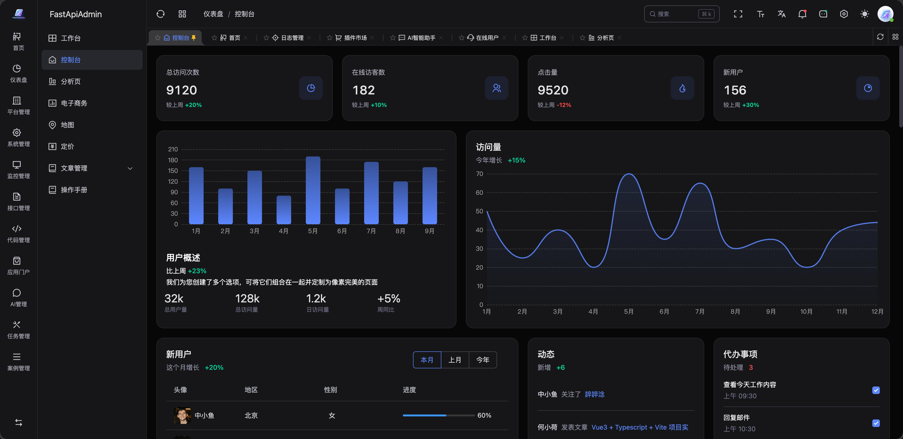
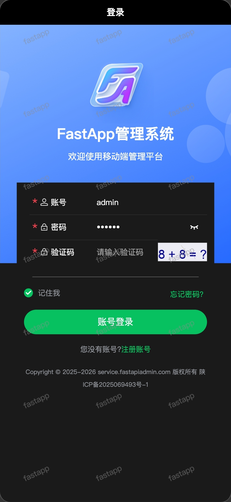
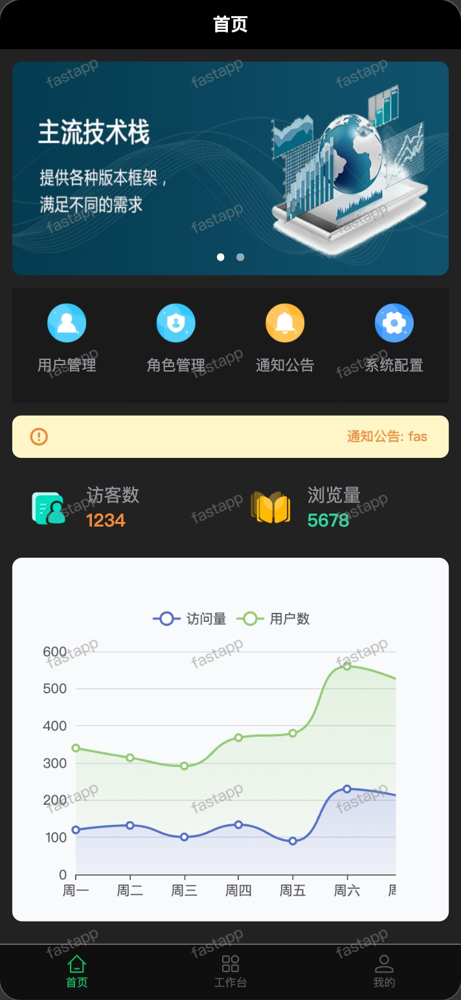
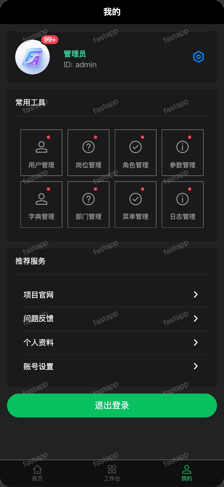
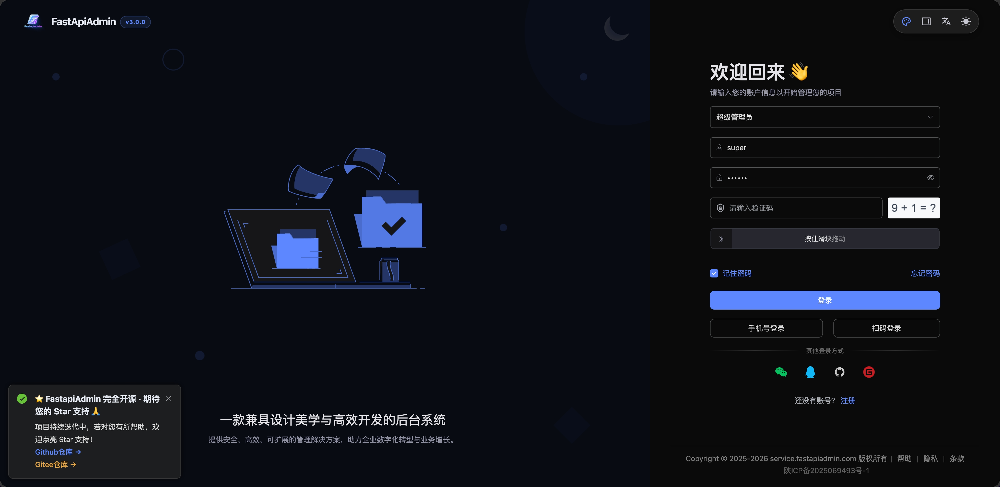
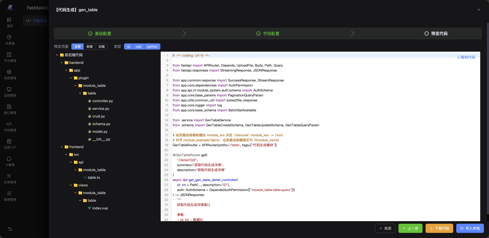
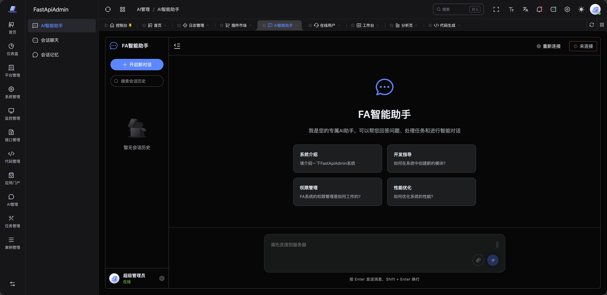

<div align="center">
     <p align="center">
          
     </p>
     <h1>FastApiAdmin <sup style="background-color: #28a745; color: white; padding: 2px 6px; border-radius: 3px; font-size: 0.4em; vertical-align: super; margin-left: 5px;">v3.0.0</sup></h1>
     <h3>🚀 One codebase for Web, H5 and Mini Program — AI code generation + RBAC + Docker, ready to ship</h3>
     <p>An enterprise full-stack foundation built on <b>FastAPI + Vue3 + TypeScript</b>: shared types, complete permissions, one source for all surfaces.</p>
     <p align="center">
          <a href="https://github.com/fastapiadmin/FastapiAdmin.git" target="_blank">
               
          </a>
          <a href="https://github.com/fastapiadmin/FastapiAdmin/forks" target="_blank">
               
          </a>
          <a href="https://gitee.com/fastapiadmin/FastapiAdmin.git" target="_blank">
               
          </a>
          <a href="https://gitee.com/fastapiadmin/FastapiAdmin.git" target="_blank">
               
          </a>
          <a href="https://atomgit.com/fastapiadmin/FastapiAdmin" target="_blank">
               
          </a>
          <br>
          <a href="https://gitee.com/fastapiadmin/FastapiAdmin/blob/master/LICENSE" target="_blank">
               
          </a>
          <a href="https://github.com/fastapiadmin/FastapiAdmin/commits" target="_blank">
               
          </a>
          
          
          
          
     </p>

English | [简体中文](./README.md)

</div>

## 🖥️ Screenshots

**Web**



**Mobile (H5 / Mini Program / App from one codebase)**

<p>



</p>

> All surfaces share one brand token set: logo, primary colors, radii, spacing, dark-mode layers, and destructive-action semantics.

## 💡 Why FastapiAdmin?

| You Need | FastapiAdmin | Django Admin | Frontend-Only |
|----------|:-----------:|:-----------:|:-------------:|
| 🎯 **Ready-to-use** admin system | ✅ | ⚠️ Limited | ❌ UI only |
| ⚡ **FastAPI async** high-performance backend | ✅ | ❌ Sync-first | ❌ No backend |
| 🔐 **RBAC** menu/button/data level permissions | ✅ | ❌ Basic | ❌ |
| 🤖 **Code generator** (table → full CRUD) | ✅ | ❌ | ❌ |
| 📱 **Mobile** (H5 + Mini Program) included | ✅ | ❌ | ❌ |
| 🐳 **Docker** one-click deploy (Nginx + SSL) | ✅ | ❌ | ❌ |

> 👉 Full comparison: [Why FastapiAdmin?](https://service.fastapiadmin.com/en/guide/why)

### ✅ A good fit for

- Teams that need a usable enterprise admin / operations system in **1–4 weeks**;
- Projects that want **shared frontend/backend types** and less API glue;
- Products that must cover **Web admin + mobile / mini program** with one domain model;
- Teams that need code generation, RBAC, audit logs and scheduled jobs as a foundation.

### ⚠️ Not a good fit for

- Full IM requirements (files, recall, read receipts, multi-device sync);
- Real-time chat / scheduling that must horizontally scale from day one (currently single-instance by design).

## 🍪 Live Demo

| | URL | Account |
|---|-----|---------|
| 💻 Web | [service.fastapiadmin.com/web](https://service.fastapiadmin.com/web) | `admin` / `123456` |
| 📱 Mobile | [service.fastapiadmin.com/app](https://service.fastapiadmin.com/app) | `admin` / `123456` |
| 📖 Official Docs | [service.fastapiadmin.com](https://service.fastapiadmin.com) | No login |

## 🚀 5–15 Minute Quick Start

```bash
# 1. Clone
git clone https://github.com/fastapiadmin/FastapiAdmin.git

# 2. Configure environments
cp backend/env/.env.example backend/env/.env.dev
cp frontend/web/.env.development.example frontend/web/.env.development

# 3. Start backend (auto-creates tables + seed data on first run)
cd backend && uv sync && uv run main.py run --env=dev

# 4. Start frontend
cd ../frontend/web && pnpm install && pnpm run dev

# ✅ Open http://127.0.0.1:5173, login with admin/123456
```

> First launch creates tables and demo data automatically. Backend defaults to `8001`, frontend to `5173`. Use Alembic migrations and dedicated secrets in production.

| Requirements | |
|-------------|------|
| Python ≥ 3.12 | Node.js ≥ 20 + pnpm |
| MySQL 8.0+ / PostgreSQL 14+ | Redis 6.x / 7.x |

### 🐳 Or: One-Command Docker Deployment

```bash
cp docker/.env.example docker/.env    # Fill in MySQL / Redis passwords
./deploy.sh                           # Build images and start the full stack (Nginx + SSL included)
```

> For ports, SSL certificates and frontend builds, see the [Docker deployment guide](docker/README.md).

## 📦 Structure

```
FastapiAdmin/            # Monorepo full-stack project
├─ backend/              # FastAPI backend (Pydantic 2.0 + SQLAlchemy + Alembic)
├─ frontend/
│   ├── web/             # Vue3 Web (Element Plus + TypeScript)
│   ├── app/             # UniApp Mobile (H5 + Mini Program + App)
│   └── docs/            # VitePress documentation
├─ docker/               # Docker Compose deploy (Nginx + SSL)
├─ deploy.sh             # One-click deploy script
└─ LICENSE               # MIT
```

## 🧱 Tech Stack

| Layer | Technology |
| --- | --- |
| Backend | FastAPI · Pydantic 2 · SQLAlchemy 2 · Alembic · Redis |
| Web | Vue 3 · TypeScript · Vite · Element Plus · Pinia · Tailwind |
| Mobile | UniApp · Vue 3 · Wot Design Uni |
| AI | Agno · pluggable model providers |
| Deploy | Docker Compose · Nginx · SSL |

## 📌 Built-in Features

> **200+ REST endpoints** · MySQL / PostgreSQL / SQLite · SFTP / S3 / OSS / COS / OBS storage adapters · Trim modules with a single `ENABLED_MODULES` entry

### Core Modules (always enabled, cannot be removed)

| Module | Capabilities |
|--------|-------------|
| 📊 Dashboard | Workbench, Analytics |
| ⚙️ System Management | Users, Roles, Menus, Departments, Positions, Dicts, Config, Notices, Tickets, Versions |
| 👀 Monitoring | Online users, Server monitoring, Cache monitoring |
| 📝 Logs | Operation audit |
| 🧰 Dev Tools | API Docs |

### Extension Modules (enabled by default, trim via `ENABLED_MODULES`)

| Module | Capabilities | Toggle |
|--------|-------------|--------|
| 🧩 Task Management | Scheduled tasks + visual workflow orchestration (built-in business nodes) | `task` |
| 🔧 Code Generator | Table → full frontend/backend code | `generator` |
| 📁 Storage | Unified file / object storage (SFTP / S3 / OSS / COS / OBS) | `storage` |
| 🤖 AI Chat | Agno-powered agent conversations | `ai` |
| 💬 Internal Chat | Text-only private / group chat between users (WebSocket real-time push + unread badge) | `chat` |

## 🔧 Module Toggling

Extension modules can be enabled/disabled on demand via `ENABLED_MODULES` in `backend/app/config/setting.py` — **just remove an item from the list; no code or menu deletion needed**. The corresponding REST endpoints, WebSocket endpoints and initialization logic will not be loaded automatically:

```python
# e.g. Disable internal chat and AI assistant, keep the rest
ENABLED_MODULES = ["generator", "task", "storage"]
```

## 🚦 Deployment Notes

- **Chat scope**: Internal chat is positioned as **lightweight internal communication** — text-only messages. **No file transfer, recall, read receipts, or multi-device sync (IM features)**. For strong IM needs, integrate mature products such as WeCom / DingTalk / Feishu. It can be disabled anytime by removing `chat` from `ENABLED_MODULES`.
- **Single-instance deployment**: Real-time features (internal chat WebSocket, scheduled task scheduler) rely on in-memory connections and local scheduling within a single instance — please deploy as a **single instance**. For horizontal scaling, integrate Redis Pub/Sub or a message queue yourself.
- **Key security**: Configure all third-party keys (AI, cloud storage, etc.) in the `backend/env/.env.*` environment variables. **Never commit them to the repository or store them in the database**.
- **Database migrations**: Manage schema changes with Alembic migrations in production (`uv run alembic upgrade head`); `create_all` is only a fallback for first-time initialization.

<details>
<summary><b>Production deployment & operations (click to expand)</b></summary>

### Architecture

| Component | Role | Public port |
| --- | --- | --- |
| nginx | TLS termination, static sites, `/api/v1` reverse proxy | 80 / 443 |
| backend | FastAPI / uvicorn (1 worker, non-root) | 127.0.0.1:8001 only |
| mysql | MySQL 8.0, volume `mysql_data` | 127.0.0.1:3306 only |
| redis | Redis 7 (sessions/cache/rate limit) | 127.0.0.1:6379 only |

Server layout: `/home/FastapiAdmin/docker` (compose, nginx, env), backups in `/home/FastapiAdmin/backups`. The server never receives source or builds; artifacts/images are built locally and delivered via `deploy-artifacts.sh`.

### Deploy

```bash
./deploy-artifacts.sh web        # build + deploy Web admin
./deploy-artifacts.sh app        # build + deploy mobile H5
./deploy-artifacts.sh backend    # build MySQL image locally -> transfer -> recreate backend
./deploy-artifacts.sh all
./deploy-artifacts.sh verify     # verify public endpoints
./deploy-artifacts.sh rollback web|app|backend
```

Every deploy backs up to `backups/<tag>-<timestamp>` first; backup failure aborts the deploy. Only changed containers are recreated.

### Secrets and rotation

`SECRET_KEY`, `DATA_ENCRYPTION_KEY`, and `DATA_ENCRYPTION_OLD_KEYS` live in the server-side `docker/.env` (never committed). To rotate: append the old data key to `DATA_ENCRYPTION_OLD_KEYS`, generate new values with `openssl rand -hex 32`, recreate backend, verify old ciphertext still decrypts, then remove obsolete old keys. Changing `SECRET_KEY` invalidates all existing tokens.

### Operations

- Daily health check: `systemctl list-timers fa-health-check.timer`; logs in `/var/log/fa-health.log`.
- Inspect: `docker compose ps`, `docker logs --tail 100 backend`, `docker inspect backend --format '{{.State.Health.Status}}'`.
- TLS certificates: `docker/nginx/ssl/server.pem`; replace cert/key then `docker exec nginx nginx -s reload`.
- Config format: `list[str]` fields must use JSON array literals (e.g. `OAUTH_ALLOWED_HOSTS=["example.com"]`), not comma-separated strings, or backend fails at startup.

### Known gaps

See [`docs/COVERAGE-PLAN.md`](docs/COVERAGE-PLAN.md). Remaining: session invalidation on disable/delete/password change, data-scope coverage on delete/clear/status paths, frontend i18n consistency, about 63% backend coverage, and external storage verification limited to MinIO/S3 (FTP/SFTP/OBS/OSS/COS excluded due to no test service).

</details>

## 📷 More Screenshots

| Login + puzzle verification | Code Generator | AI Assistant |
| ---- | -------- | ------- |
|  |  |  |

> Screenshots come from the current release: light theme, real API data and the latest brand visuals.

## ❓ FAQ

**Q: Login says the captcha is invalid?**  
A: Make sure Redis is running, then complete the puzzle verification. The development credentials are `admin / 123456`.

**Q: Can I use only the Web app?**  
A: Yes. `frontend/web` runs independently; the mobile project is optional.

**Q: How do I trim modules?**  
A: Edit `ENABLED_MODULES` in `backend/app/config/setting.py`; endpoints and initialization are unloaded automatically.

**Q: How should production initialize the database?**  
A: Run `uv run alembic upgrade head`; do not rely on `create_all`.

## 📖 Documentation

- 🌐 [Official Docs](https://service.fastapiadmin.com) — Full guides, architecture, custom development
- 📁 Sub-project READMEs: [backend](backend/README.md) · [web](frontend/web/README.md) · [mobile](frontend/app/README.md) · [Docker](docker/README.md)

## 🤝 Contributing

Issues and PRs are welcome! See [Contributing Guide](https://service.fastapiadmin.com/en/about/contributing).

## 👥 Community

<p>


</p>

## ⭐ Star History

[](https://star-history.com/#fastapiadmin/FastapiAdmin&Date)

## 👥 Contributors

> Thank you to all contributors who have contributed code to FastapiAdmin.

<a href="https://github.com/fastapiadmin/FastapiAdmin/graphs/contributors">
  
</a>

## 🙏 Acknowledgments

> If you find this project useful, please give it a ⭐️ Star!

- Backend: [FastAPI](https://fastapi.tiangolo.com/) · [Pydantic](https://docs.pydantic.dev/) · [SQLAlchemy](https://www.sqlalchemy.org/) · [APScheduler](https://github.com/agronholm/apscheduler)
- Frontend: [Vue3](https://vuejs.org/) · [TypeScript](https://www.typescriptlang.org/) · [Vite](https://vitejs.dev/) · [Element Plus](https://element-plus.org/)
- Mobile: [UniApp](https://uniapp.dcloud.net.cn/) · [Wot Design Uni](https://wot-ui.cn/)
- AI: [Agno](https://github.com/agno-agi/agno)
