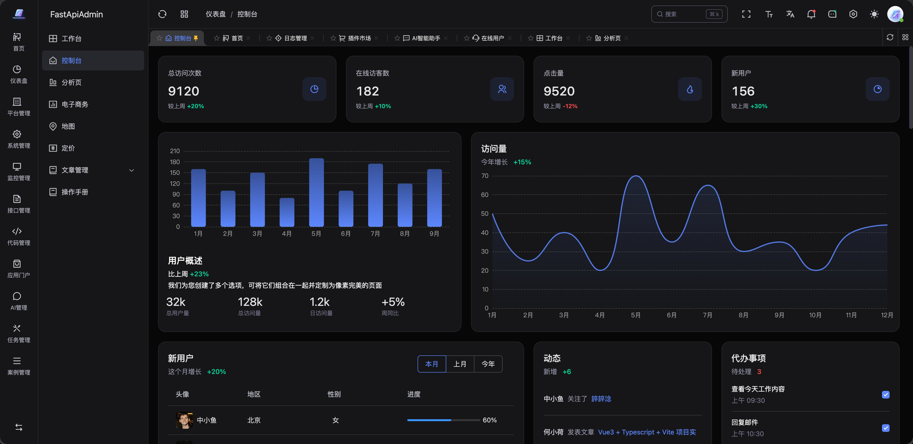
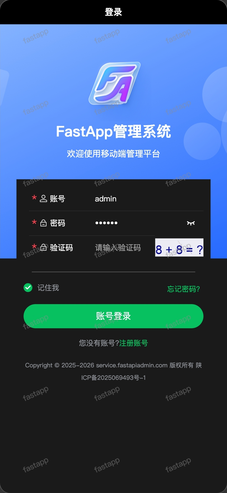
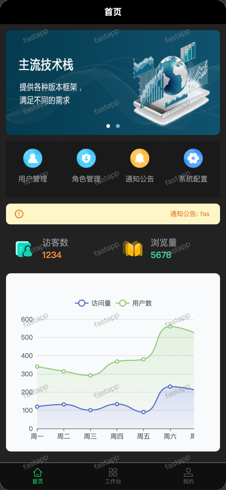
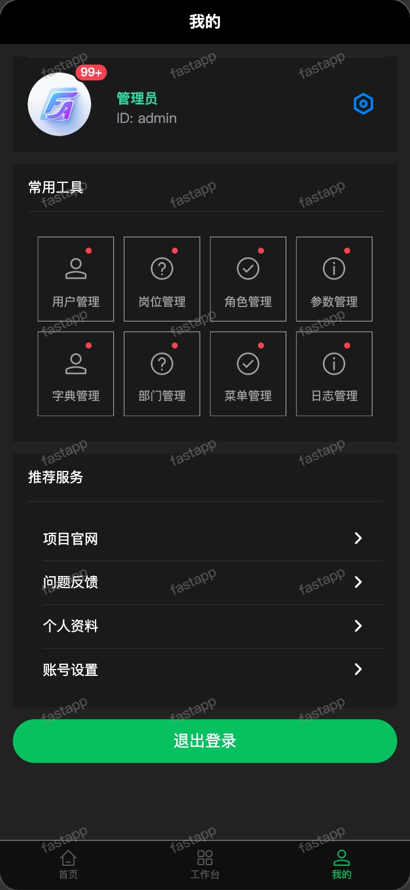
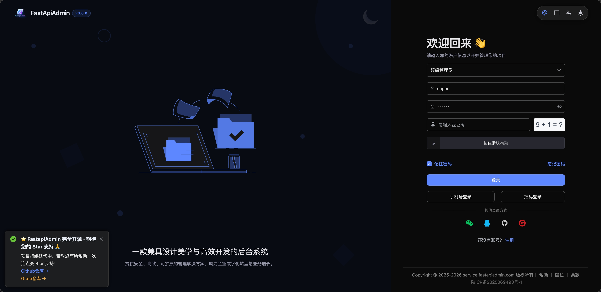
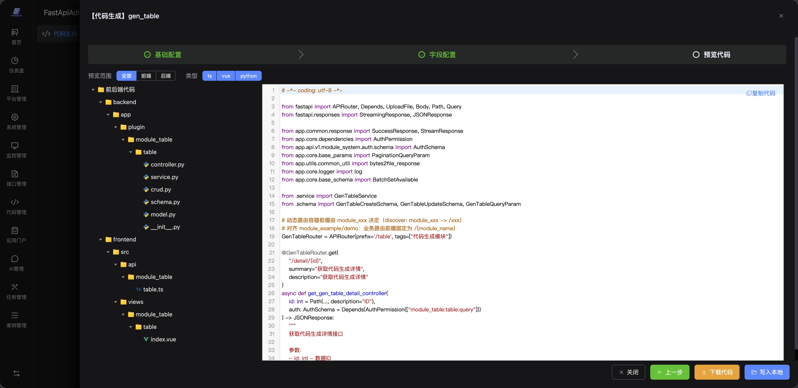
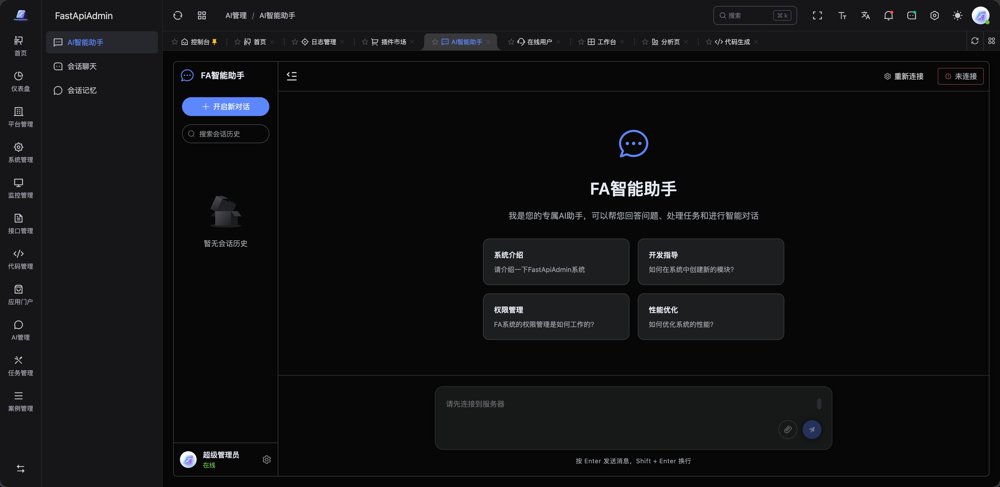

<div align="center">
     <p align="center">
          
     </p>
     <h1>FastApiAdmin <sup style="background-color: #28a745; color: white; padding: 2px 6px; border-radius: 3px; font-size: 0.4em; vertical-align: super; margin-left: 5px;">v3.0.0</sup></h1>
     <h3>🚀 一套代码交付 Web / H5 / 小程序，AI 代码生成 + RBAC + Docker 开箱即用</h3>
     <p>基于 <b>FastAPI + Vue3 + TypeScript</b> 的企业级全栈底座：类型共享、权限完整、三端同源</p>
     <p align="center">
          <a href="https://github.com/fastapiadmin/FastapiAdmin.git" target="_blank">
               
          </a>
          <a href="https://github.com/fastapiadmin/FastapiAdmin/forks" target="_blank">
               
          </a>
          <a href="https://gitee.com/fastapiadmin/FastapiAdmin.git" target="_blank">
               
          </a>
          <a href="https://gitee.com/fastapiadmin/FastapiAdmin.git" target="_blank">
               
          </a>
          <a href="https://atomgit.com/fastapiadmin/FastapiAdmin" target="_blank">
               
          </a>
          <br>
          <a href="https://gitee.com/fastapiadmin/FastapiAdmin/blob/master/LICENSE" target="_blank">
               
          </a>
          <a href="https://github.com/fastapiadmin/FastapiAdmin/commits" target="_blank">
               
          </a>
          
          
          
          
     </p>

简体中文 | [English](./README.en.md)

</div>

## 🤖 让 AI 在这个项目里干活

把这个仓库交给 AI 时，先让它读根目录的 [`SKILL.md`](./SKILL.md)：

- 工程地图与前后端约定；
- 本地启动、测试、构建命令；
- 测试用例设计、`e2e_` 测试数据和清理规范；
- 时间/消息/调度契约；
- 生产部署、备份和不可逆操作边界；
- 当前已统一的账号/角色编码契约。

测试覆盖与执行记录见 [`docs/COVERAGE-PLAN.md`](./docs/COVERAGE-PLAN.md)。AI 不应只凭“页面能打开”判断功能通过，写操作必须真实执行并清理测试数据。

## 🖥️ 界面一览

**Web 端**



**移动端（H5 / 小程序 / App 同一套代码）**

<p>



</p>

> 三端共享同一套品牌 Token：Logo、主色、圆角、间距、深色层级与危险操作语义保持一致。

## 💡 为什么选择 FastapiAdmin？

| 你需要的 | FastapiAdmin | Django Admin | 纯前端模板 |
|---------|:-----------:|:-----------:|:---------:|
| 🎯 **开箱即用**的后台系统 | ✅ | ⚠️ 功能有限 | ❌ 只有 UI |
| ⚡ **FastAPI 异步**高性能后端 | ✅ | ❌ 同步为主 | ❌ 无后端 |
| 🔐 **RBAC** 菜单/按钮/数据三级权限 | ✅ | ❌ 基础 | ❌ |
| 🤖 **代码生成器**（选表 → 出前后端代码） | ✅ | ❌ | ❌ |
| 📱 **移动端**（H5 + 小程序）一体 | ✅ | ❌ | ❌ |
| 🐳 **Docker 一键部署**（含 Nginx + SSL） | ✅ | ❌ | ❌ |

> 👉 详细技术选型对比：[为什么选择 FastapiAdmin？](https://service.fastapiadmin.com/guide/why)

### ✅ 适合这些场景

- 需要在 **1–4 周**内交付可用的企业后台、运营系统或客户项目；
- 团队希望 **前后端类型共享**，减少接口联调与重复建模；
- 同一业务要同时覆盖 **Web 管理端 + 移动端 / 小程序**；
- 需要代码生成、RBAC、审计日志、定时任务等“底座能力”，而不是从零搭。

### ⚠️ 不适合

- 需要完整 IM（文件、撤回、已读回执、多端同步）的场景；
- 一开始就要求多实例水平扩展的实时聊天 / 调度场景（当前按单实例设计）。

## 🍪 在线体验

| 端 | 地址 | 账号 |
|----|------|------|
| 💻 Web 端 | [service.fastapiadmin.com/web](https://service.fastapiadmin.com/web) | `admin` / `123456` |
| 📱 移动端 | [service.fastapiadmin.com/app](https://service.fastapiadmin.com/app) | `admin` / `123456` |
| 📖 官方文档 | [service.fastapiadmin.com](https://service.fastapiadmin.com) | 无需登录 |

## 🚀 5–15 分钟本地跑起来

```bash
# 1. 克隆
git clone https://gitee.com/fastapiadmin/FastapiAdmin.git

# 2. 配置环境
cp backend/env/.env.example backend/env/.env.dev
cp frontend/web/.env.development.example frontend/web/.env.development

# 3. 启动后端（首次自动建表 + 初始化数据）
cd backend && uv sync && uv run main.py run --env=dev

# 4. 启动前端
cd ../frontend/web && pnpm install && pnpm run dev

# ✅ 浏览器打开 http://127.0.0.1:5173，用 admin/123456 登录
```

> 首次启动会自动建表并写入演示数据；后端默认 `8001`，前端默认 `5173`。生产环境请使用 Alembic 迁移与独立密钥。

| 环境要求 | |
|---------|------|
| Python ≥ 3.12 | Node.js ≥ 20.0 + pnpm |
| MySQL 8.0+ / PostgreSQL 14+ | Redis 6.x / 7.x |

### 🐳 或者：Docker 一键部署

```bash
cp docker/.env.example docker/.env    # 填写 MySQL / Redis 密码
./deploy.sh local                     # 本机构建并启动全栈（含 Nginx + SSL）
```

> 端口、SSL 证书、前端构建等细节见 [Docker 部署文档](docker/README.md)。

## 📦 工程结构

```
FastapiAdmin/            # Monorepo 全栈工程
├─ backend/              # FastAPI 后端（Pydantic 2.0 + SQLAlchemy + Alembic）
├─ frontend/
│   ├── web/             # Vue3 Web 前端（Element Plus + TypeScript）
│   ├── app/             # UniApp 移动端（H5 + 小程序 + App）
│   └── docs/            # VitePress 文档网站
├─ docker/               # Docker Compose 一键部署（Nginx + SSL）
├─ deploy.sh             # 一键部署脚本
└─ LICENSE               # MIT 开源协议
```

## 🧱 技术栈

| 层 | 技术 |
| --- | --- |
| 后端 | FastAPI · Pydantic 2 · SQLAlchemy 2 · Alembic · Redis |
| Web | Vue 3 · TypeScript · Vite · Element Plus · Pinia · Tailwind |
| 移动端 | UniApp · Vue 3 · Wot Design Uni |
| AI | Agno · 可切换模型供应商 |
| 部署 | Docker Compose · Nginx · SSL |

## 📌 内置功能

> **200+ REST 接口** · MySQL / PostgreSQL / SQLite 三方言 · SFTP / S3 / OSS / COS / OBS 五种存储协议 · `ENABLED_MODULES` 一行开关裁剪模块

### 核心模块（始终启用，不可裁剪）

| 模块 | 包含能力 |
|------|---------|
| 📊 仪表盘 | 工作台、数据分析 |
| ⚙️ 系统管理 | 用户 / 角色 / 菜单 / 部门 / 岗位 / 字典 / 参数 / 公告 / 工单 / 版本 |
| 👀 监控管理 | 在线用户 / 服务器监控 / 缓存监控 |
| 📝 日志管理 | 操作日志审计 |
| 🧰 开发工具 | 接口文档 |

### 扩展模块（默认启用，可用 `ENABLED_MODULES` 裁剪）

| 模块 | 包含能力 | 裁剪开关 |
|------|---------|---------|
| 🧩 任务管理 | 定时任务调度 + 可视化工作流编排（内置业务节点） | `task` |
| 🔧 代码生成器 | 选表 → 生成前后端全量代码 | `generator` |
| 📁 数据存储 | 统一文件 / 对象存储（SFTP / S3 / OSS / COS / OBS） | `storage` |
| 🤖 AI 对话 | 基于 Agno 的智能体对话 | `ai` |
| 💬 内部聊天 | 系统内用户**纯文字**私聊 / 群聊（WebSocket 实时推送 + 未读角标） | `chat` |

## 🔧 模块裁剪

扩展模块可通过 `backend/app/config/setting.py` 中的 `ENABLED_MODULES` 按需启用 / 停用——**移除列表项即可，无需删除任何代码或菜单**，对应的 REST 接口、WebSocket 端点与初始化逻辑将自动不加载：

```python
# 例如：停用内部聊天与 AI 对话，保留其余扩展模块
ENABLED_MODULES = ["generator", "task", "storage"]
```

## 🚦 部署说明

- **聊天边界**：内部聊天定位为**轻量内部沟通**，仅支持纯文字消息，**不含文件传输、撤回、已读回执、多端同步等 IM 能力**；如有强 IM 需求，请对接企业微信 / 钉钉 / 飞书等成熟产品。随时可在 `ENABLED_MODULES` 中移除 `chat` 停用。
- **单实例部署**：实时功能（内部聊天 WebSocket、定时任务调度器）基于单实例内存连接与本地调度实现，请以**单实例方式**部署。如需水平扩展，请自行引入 Redis Pub/Sub 或消息队列。
- **密钥安全**：所有第三方密钥（AI、云存储等）请配置在 `backend/env/.env.*` 环境变量中，**切勿提交到仓库或写入数据库**。
- **数据库迁移**：正式环境请使用 Alembic 迁移（`uv run alembic upgrade head`）管理表结构变更，`create_all` 仅用于首次初始化的兜底。

<details>
<summary><b>生产部署运维手册（点击展开）</b></summary>

---

## 1. 架构与目录

| 组件 | 说明 | 对外端口 |
| --- | --- | --- |
| nginx | TLS 终止、静态站点、反向代理 `/api/v1` | 80 / 443 |
| backend | FastAPI（uvicorn，1 worker，非 root 运行 uid=1000） | 仅 127.0.0.1:8001 |
| mysql | MySQL 8.0，数据卷 `mysql_data` | 仅 127.0.0.1:3306 |
| redis | Redis 7（会话/缓存/限流） | 仅 127.0.0.1:6379 |

服务器布局（`/home/FastapiAdmin`）：

```
docker/                     # 唯一部署目录，不含业务源码
├── docker-compose.yaml     # 服务编排（端口仅 127.0.0.1，密钥由 .env 注入）
├── docker-compose.override.yaml  # nginx 版本固定 + 缓存配置挂载 + ACME 目录
├── .env                    # 真实凭据（600，不入库）
├── .env.example            # 占位模板（入库）
├── backend/Dockerfile      # 源码构建路径（正式部署不用它）
├── nginx/
│   ├── nginx.conf          # 站点配置（含文档封堵、隐藏文件拒绝、ACME 放行）
│   ├── cache-headers.inc   # 静态资源长缓存片段
│   ├── acme/               # ACME http-01 校验目录
│   ├── ssl/                # 证书与私钥（600，不入库）
│   └── {web,app,docs}/dist # 三端静态成品（由本地构建后上传）
└── mysql/ redis/           # 初始化 SQL 与 redis.conf
backups/                    # 部署前自动备份（每类保留 5 份）
```

仓库侧：`deploy.sh`（本机执行的成品部署脚本）、`backend/requirements/`（依赖分组）、`.github/workflows/`（CI）。

---

## 2. 日常部署

在本机仓库根目录执行（需要本机可免密 SSH 到服务器、且本机 Docker 可用——`colima start`）：

```bash
./deploy.sh web        # 构建并部署 Web 管理后台
./deploy.sh app        # 构建并部署移动端 H5
./deploy.sh backend    # 本地构建 MySQL 版镜像 → 传输 → 只重建 backend
./deploy.sh all        # 三样全发
./deploy.sh verify     # 公网四端验证
./deploy.sh backups    # 列出服务器备份
./deploy.sh prune      # 轮转清理旧备份与旧镜像
./deploy.sh rollback web|app|backend
```

要点：

- **服务器不接收源码、不执行构建**：后端以 `docker save → ssh → docker load` 交付镜像，前端以 tar 管道交付成品。
- 每次部署前自动备份到 `backups/<标签>-<时间戳>`，备份失败即中止，不会带着假备份上线。
- 只重建变化的容器；MySQL/Redis/Nginx 不受影响。
- PostgreSQL 版本镜像：`./deploy.sh backend-pg`（**只构建与自检，不切换线上**）。切换需人工把 `BACKEND_IMAGE_TAG` 指到该镜像并确保 compose 的数据库配置已改。

---

## 3. 密钥与口令

| 项 | 位置 | 说明 |
| --- | --- | --- |
| `SECRET_KEY` | 服务器 `docker/.env` | JWT 签名密钥，64 位 hex，随机生成 |
| `DATA_ENCRYPTION_KEY` | 服务器 `docker/.env` | 落库敏感数据加密主密钥 |
| `DATA_ENCRYPTION_OLD_KEYS` | 服务器 `docker/.env` | 轮换前的旧密钥，仅用于解密历史密文 |
| 种子账号口令 | 服务器 `/root/.fa-seed-passwords`（600） | `super`/`admin`/`user`，登录后请自行修改并删除该文件 |

**轮换密钥的正确步骤**（不可跳步，否则历史密文无法解密）：

1. 把当前 `DATA_ENCRYPTION_KEY`（未设置时取当前 `SECRET_KEY`）追加到 `DATA_ENCRYPTION_OLD_KEYS`；
2. 生成新值：`openssl rand -hex 32`，写入 `SECRET_KEY` / `DATA_ENCRYPTION_KEY`；
3. `docker compose up -d --force-recreate backend`；
4. 验证历史密文仍可解密（例如存储源口令），再删除 `OLD_KEYS` 中不再需要的旧值。

> 注意：更换 `SECRET_KEY` 会使已签发的令牌全部失效，用户需重新登录。

---

## 4. 运行状态与巡检

- **每日巡检**：`systemctl list-timers fa-health-check.timer`（每天 08:30，带 5 分钟随机延迟）
- 巡检内容：4 个容器健康、`/api/v1/monitor/health/check` 与 `/web/`、`/app/` 可用性、证书剩余天数、磁盘、swap、备份与镜像堆积
- 结果：`/var/log/fa-health.log`；有告警时写入 syslog（`journalctl -t fa-health`）且服务退出码非 0
- 手动执行：`systemctl start fa-health-check.service && tail -n 30 /var/log/fa-health.log`

常用排查命令：

```bash
cd /home/FastapiAdmin/docker
docker compose ps
docker logs --tail 100 backend
docker inspect backend --format '{{.State.Health.Status}}'
ss -tlnp | grep docker-proxy      # 确认对外只有 80/443
```

---

## 5. 证书

- 当前证书：`docker/nginx/ssl/server.pem`（`CN=service.fastapiadmin.com`），由巡检脚本监控到期天数
- 续期（重新签发后）：替换 `server.pem` 与 `server.key` → `docker exec nginx nginx -s reload`
- 已放行 ACME http-01 校验路径（`/.well-known/acme-challenge/` → `docker/nginx/acme`），如需切换到 acme.sh 自动续期，把校验文件写入该目录即可，无需再改 nginx 配置

---

## 6. 配置取值格式（踩过的坑）

`.env` / compose 里的取值格式取决于应用侧字段类型：

| 类型 | 写法 | 例子 |
| --- | --- | --- |
| `str`（应用内部再按逗号拆） | 逗号分隔字符串 | `PROD_CORS_ORIGINS=https://a.com,https://b.com` |
| `list[str]`（pydantic-settings 直接解析） | **必须 JSON 数组字面量** | `OAUTH_ALLOWED_HOSTS=["service.fastapiadmin.com","*.fastapiadmin.com"]` |

把 `list[str]` 字段写成逗号分隔字符串会让应用**启动期抛 `SettingsError`**，容器不断重启、网关返回 502。2026-10-04 的部署事故就是这个原因（已修复并在 compose 默认值里固化 JSON 形态）。

排查方式：`docker logs --tail 40 backend`，若看到
`pydantic_settings.exceptions.SettingsError: error parsing value for field "XXX" from source "EnvSettingsSource"`，
就是该字段的取值格式与类型不匹配。

## 7. 凭据轮换（生产）

轮换对象：MySQL 应用用户 / MySQL root / Redis。三者都通过 `docker/.env` 注入，且
**镜像内不得包含任何口令**（`deploy.sh` 在构建上下文里剔除
`DATABASE_PASSWORD / REDIS_PASSWORD / SECRET_KEY / DATA_ENCRYPTION_KEY` 等键，
仅保留主机名、端口等非敏感项——审计 B3 的根治）。

标准步骤（约 1 分钟中断窗口，顺序不可颠倒）：

```bash
cd /home/FastapiAdmin/docker
cp -a .env ".env.bak-rotate-$(date +%Y%m%d-%H%M%S)"   # 先备份，便于回滚

# 1) 改数据库口令（用 stdin 传 SQL，避免口令出现在命令行历史/ps）
NEW=$(openssl rand -base64 36 | tr -d '/+=' | cut -c1-30)
docker exec -i -e MYSQL_PWD="$MYSQL_ROOT_PASSWORD" mysql mysql -uroot <<SQL
ALTER USER 'fastapiadmin'@'%' IDENTIFIED BY '$NEW';
FLUSH PRIVILEGES;
SQL

# 2) 同步写入 .env（键名：MYSQL_PASSWORD）
# 3) 重建引用该值的容器：mysql → redis → backend
#    注意：mysql/redis 的健康检查命令内插了 .env 值，必须一并重建，否则健康检查会一直失败
docker compose up -d --force-recreate mysql && sleep 20
docker compose up -d --force-recreate redis
docker compose up -d --force-recreate backend

# 4) 验证：旧口令必须被拒（1045 / WRONGPASS），新口令可用，健康检查 db_status/redis_status = 1
```

排查提示：`docker exec -i` 会让容器内进程读走脚本自身的 stdin（若脚本经 `bash -s` 传入，
后续步骤会被吞掉）——务必加 `</dev/null` 或改用 `-e` 直传。

## 8. 已知遗留问题

当前覆盖基线与剩余缺口见 [`docs/COVERAGE-PLAN.md`](docs/COVERAGE-PLAN.md)。仍需关注：

1. 会话失效机制：停用/删除/改密后旧会话仍有效（最长 7 天），需应用侧继续改造；
2. 数据权限注入完整性：删除/清空/改状态等路径需继续核验；
3. 前端 i18n、通知状态枚举与后端语义一致性；
4. 后端覆盖仍为约 63%，`gencode` 生成写入/同步、OAuth/微信登录、AI 主流程、调度器对账和前端全源码仍未完成；
5. 外部存储仅验证 MinIO/S3；FTP/SFTP/OBS/OSS/COS 当前无测试服务，未纳入本轮验收。

</details>

## 📷 更多截图

| 登录 + 拼图验证 | 代码生成 | AI 助手 |
| ---- | -------- | ------- |
|  |  |  |

> 截图来自当前版本：浅色主题、真实接口数据与最新品牌视觉。

## ❓ 常见问题

**Q：启动后登录提示验证码错误？**  
A：确认后端 Redis 正常，并完成页面拼图验证；开发环境账号为 `admin / 123456`。

**Q：可以只用 Web 端吗？**  
A：可以。`frontend/web` 可独立启动；移动端工程独立，不影响 Web。

**Q：如何裁剪模块？**  
A：修改 `backend/app/config/setting.py` 的 `ENABLED_MODULES`，接口与初始化逻辑会自动卸载。

**Q：生产环境数据库怎么初始化？**  
A：使用 `uv run alembic upgrade head`，不要依赖 `create_all`。

## 📖 文档地址

- 🌐 [官网文档](https://service.fastapiadmin.com) — 完整开发指南、架构设计、二开教程
- 📁 子工程 README：[backend](backend/README.md) · [web](frontend/web/README.md) · [移动端](frontend/app/README.md) · [Docker](docker/README.md)

## 🤝 参与贡献

欢迎提交 Issue / PR！详见 [贡献指南](https://service.fastapiadmin.com/about/contributing)。

## 👥 社区与支持

<p>


</p>

## ⭐ Star History

[](https://star-history.com/#fastapiadmin/FastapiAdmin&Date)

## 👥 贡献者
> 感谢以下所有给 FastapiAdmin 贡献过代码的 开发者。

<a href="https://github.com/fastapiadmin/FastapiAdmin/graphs/contributors">
  
</a>

## 🙏 鸣谢

> 如果你觉得项目有用，请给一个 ⭐️ Star 支持！

- 后端：[FastAPI](https://fastapi.tiangolo.com/) · [Pydantic](https://docs.pydantic.dev/) · [SQLAlchemy](https://www.sqlalchemy.org/) · [APScheduler](https://github.com/agronholm/apscheduler)
- 前端：[Vue3](https://cn.vuejs.org/) · [TypeScript](https://www.typescriptlang.org/) · [Vite](https://vitejs.dev/) · [Element Plus](https://element-plus.org/)
- 移动端：[UniApp](https://uniapp.dcloud.net.cn/) · [Wot Design Uni](https://wot-ui.cn/)
- AI：[Agno](https://github.com/agno-agi/agno)
